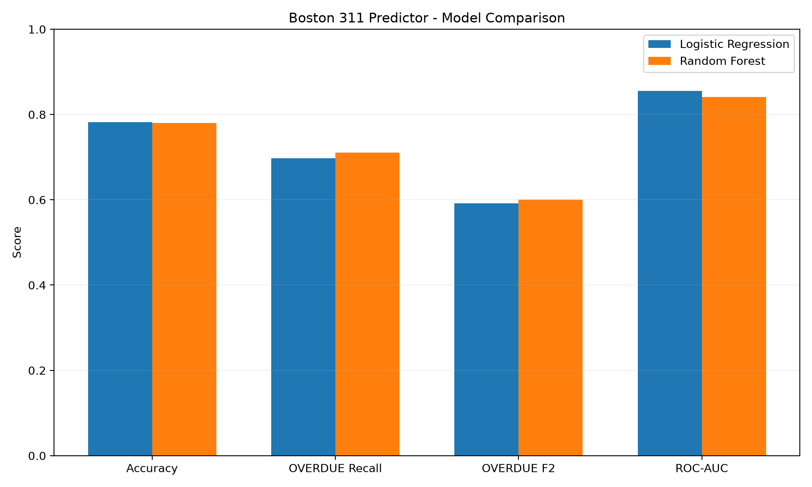
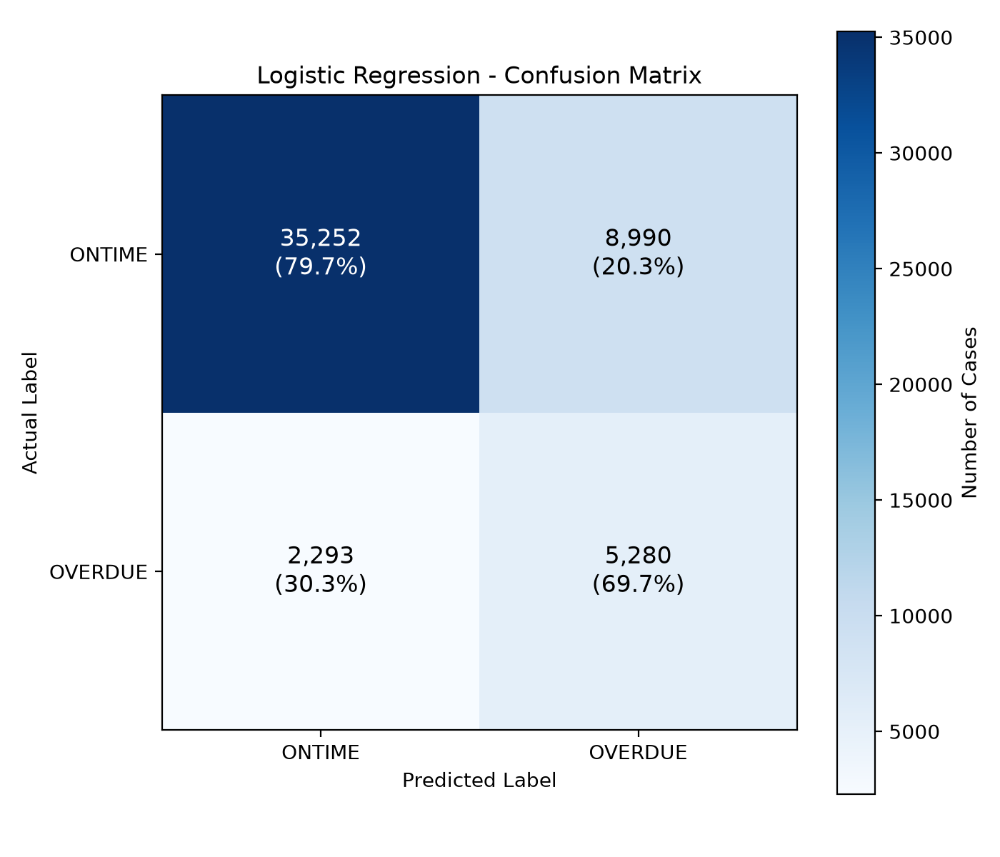

# Boston 311 Predictor

A machine learning project that analyzes Boston's 311 service request data and predicts whether a service request is likely to be completed on time or overdue.

The project uses historical municipal service data, feature engineering, classification models, and threshold optimization to explore how machine learning can support early identification of potentially overdue requests.

## Overview

Boston 311 is a public service system that allows residents to report non-emergency issues such as street cleaning, parking enforcement, sanitation, and infrastructure maintenance.

This project uses Boston's 2024 service request records to build and evaluate machine learning models for predicting request outcomes.

The primary prediction task is binary classification:

- **ONTIME (0):** The request is recorded as completed on time.
- **OVERDUE (1):** The request is recorded as overdue.

The current version focuses on retrospective model evaluation rather than deployment in a live municipal service system.

## Key Features

- Official Boston 311 dataset collection
- Data cleaning and exploratory data analysis
- Time-based feature engineering
- Chronological train, validation, and test splits
- Logistic Regression classification
- Random Forest classification
- Classification threshold optimization
- Precision, Recall, F1, F2, and ROC-AUC evaluation
- Confusion matrix visualization
- Model comparison
- Trained model saving and loading using Joblib
- Single-request prediction using saved models

## Technologies Used

- Python
- pandas
- NumPy
- scikit-learn
- Matplotlib
- Requests
- Joblib
- Git and GitHub

## Dataset

**Source:** [Boston Open Data - 311 Service Requests](https://data.boston.gov/dataset/311-service-requests)

**Year:** 2024

**Total Records:** 306,756

The dataset includes information about service request categories, submission channels, neighborhoods, creation dates, case status, and service outcomes.

The raw dataset is excluded from this repository because of its file size. A download script is provided to retrieve the data from the official source.

## Machine Learning Workflow

The project follows these steps:

1. Download the official Boston 311 dataset.
2. Explore data distributions and missing values.
3. Clean and prepare historical service requests.
4. Engineer time-based features from request creation dates.
5. Split data chronologically to reduce temporal data leakage.
6. Train Logistic Regression and Random Forest models.
7. Select classification thresholds using validation data.
8. Evaluate models on a later test period.
9. Save trained models and generate predictions.
10. Visualize results and compare model performance.


## Model Evaluation Results

Two classification models were trained and evaluated using Boston 311 service request records from 2024:

- Logistic Regression
- Random Forest Classifier

### Dataset Splitting

The project uses chronological data splitting instead of a random train/test split.

| Dataset | Period | Purpose |
|---|---|---|
| Training | January–June 2024 | Train models for validation |
| Validation | July–September 2024 | Compare models and select classification thresholds |
| Final Model Training | January–September 2024 | Retrain models using historical cases closed before October 1 |
| Test | October–December 2024 | Evaluate selected models on later historical requests |

Only cases with known final outcomes were used. Training records were restricted to cases closed before the corresponding training cutoff to reduce temporal data leakage.

The final model training set contained **195,056 records**, and the test set contained **51,815 records**.

### Model Performance

The classification thresholds were selected using validation data, with particular attention to identifying potentially overdue requests.

| Metric | Logistic Regression | Random Forest |
|---|---:|---:|
| Classification Threshold | 0.20 | 0.50 |
| Accuracy | 78.22% | 78.03% |
| OVERDUE Precision | 0.370 | 0.369 |
| OVERDUE Recall | 0.697 | 0.711 |
| OVERDUE F1 Score | 0.48 | 0.49 |
| OVERDUE F2 Score | 0.592 | 0.600 |
| ROC-AUC | 0.8555 | 0.8414 |

**Baseline Comparison:** A majority-class classifier that always predicts ONTIME achieves 85.38% accuracy on the test set.

Although both models have lower overall accuracy at their selected thresholds, they can identify a substantial proportion of overdue requests. The selected thresholds prioritize OVERDUE recall rather than maximizing accuracy.

### Key Findings

- Both models achieved approximately 78% accuracy at their selected thresholds.
- Random Forest identified slightly more overdue cases, achieving 71.1% recall compared with 69.7% for Logistic Regression.
- Logistic Regression achieved a higher ROC-AUC, indicating better overall class discrimination on this test set.
- Lower classification thresholds improved overdue detection but increased false-positive predictions.
- Neither model was consistently superior across all evaluation metrics.

The results highlight the trade-off between detecting potentially overdue service requests and producing unnecessary alerts.

**Evaluation note:** These results represent retrospective performance on cases recorded as closed. They do not establish performance on all newly submitted requests. The test period had also been inspected during model development, so the evaluation should not be considered a fully untouched blind test.


## Visualizations

### Model Comparison

The following chart compares Logistic Regression and Random Forest performance on the 2024 test period.



### Confusion Matrices

The confusion matrices show correct classifications, false-positive alerts, and missed overdue requests.

**Logistic Regression**



**Random Forest**


Random Forest correctly identified 5,381 overdue requests, compared with 5,280 for Logistic Regression. However, it also produced 201 additional false-positive alerts.


## Installation

### 1. Clone the Repository

```bash
git clone https://github.com/Ahao-cmd/boston-311-predictor.git
cd boston-311-predictor
```

### 2. Create a Virtual Environment

```bash
python3 -m venv .venv
source .venv/bin/activate
```

For Windows users, activate the environment using:

```powershell
.venv\Scripts\Activate.ps1
```

### 3. Install Dependencies

```bash
python -m pip install -r requirements.txt
```

All required Python libraries are listed in `requirements.txt`.

### 4. Download the Dataset

Run the dataset download script:

```bash
python src/download_full_data.py
```

The script downloads the 2024 Boston 311 service request dataset from the official Boston Open Data portal.

The downloaded CSV is saved to:

```text
data/raw/boston_311_2024_full.csv
```

The dataset contains 306,756 records in the version used for this project. The downloaded record count may change if the official source is updated.

Raw datasets are excluded from Git to avoid committing large files.


## Usage

### Optional: Validate Classification Thresholds

The classification thresholds were selected using a separate validation period.

Run the Logistic Regression validation:

```bash
python src/validate_thresholds.py
```

Run the Random Forest validation:

```bash
python src/validate_random_forest.py
```

These scripts compare Precision, Recall, and F2 Score across classification thresholds.

### 1. Train the Models

Train the Logistic Regression model:

```bash
python src/train_full_baseline.py
```

Train the Random Forest model:

```bash
python src/train_full_random_forest.py
```

Both scripts train and evaluate their respective models using chronological data splits.

The trained pipelines are saved to:

```text
models/
├── logistic_regression_v1.joblib
└── random_forest_v1.joblib
```

Each saved model includes its preprocessing pipeline, required input features, classification threshold, and class labels.

The generated model files are excluded from Git and must be created locally.

### 2. Verify Model Loading

```bash
python src/test_model_loading.py
```

This script verifies that both saved models can be loaded successfully.

### 3. Predict a Service Request

Run the example prediction script:

```bash
python src/predict_case.py
```

The script loads both trained models and evaluates a sample service request containing:

- Service request subject
- Reason and type
- Submission source
- Neighborhood
- Request creation weekday and hour

Each model outputs an OVERDUE risk score and a predicted class.

The example request can be modified by editing the `request` dictionary in `src/predict_case.py`.

### 4. Generate Visualizations

```bash
python src/create_visualizations.py
```

The script generates:

```text
assets/
├── model_comparison.png
├── confusion_matrix_logistic.png
└── confusion_matrix_random_forest.png
```

These charts summarize the recorded model evaluation results.

**Note:** The visualization script currently uses previously recorded evaluation metrics rather than recalculating them from newly trained models. If experiments are changed, the chart values must also be updated.


## Known Limitations

The current version has several limitations:

- **Closed-case selection bias:** Model evaluation only includes service requests recorded as closed. Open or unresolved requests are excluded, which may affect how well the results represent all newly submitted cases.

- **Temporal data limitations:** Models were trained and evaluated using 2024 records. Changes in service demand, departmental operations, or municipal policies may affect performance in future years.

- **Feature availability:** The models use request categories, submission sources, neighborhoods, and creation-time features. Some category fields may be updated during case processing, so their availability at the exact time of submission requires further verification.

- **Uncalibrated risk scores:** The models output OVERDUE classification scores, but these scores have not been calibrated or validated as real-world probabilities.

- **False-positive alerts:** Lower classification thresholds increase the detection of overdue requests but also produce more incorrect alerts.

- **Evaluation limitations:** The results are based on retrospective testing. The final test period was also inspected during development, so it should not be considered a fully untouched blind evaluation.

- **Model generalization:** Performance may vary across different neighborhoods, request types, and time periods.

- **Not production-ready:** The project is an experimental machine learning system and has not been deployed or validated for real-time municipal decision-making.


## Future Improvements

Potential improvements for future versions include:

- **Additional training data:** Expand the dataset to multiple years to evaluate long-term changes in service request patterns.

- **Improved temporal evaluation:** Use historical data snapshots and additional out-of-time test sets to better simulate real-world predictions.

- **Probability calibration:** Apply calibration techniques to make model risk scores more interpretable and reliable.

- **Feature engineering:** Explore additional geographic, temporal, and historical workload features that would be available when a request is submitted.

- **Model optimization:** Experiment with hyperparameter tuning and additional classification algorithms.

- **Automated evaluation:** Generate evaluation metrics and visualization charts directly from model predictions instead of manually recorded results.

- **Interactive prediction interface:** Build a simple web application that allows users to enter service request information and view model predictions.

- **Model monitoring:** Investigate performance changes across request categories, neighborhoods, and time periods.

The long-term goal is to develop a more reproducible and reliable machine learning workflow for studying municipal service request outcomes.
